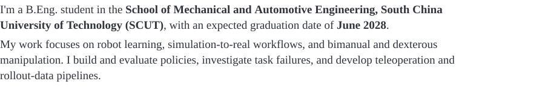
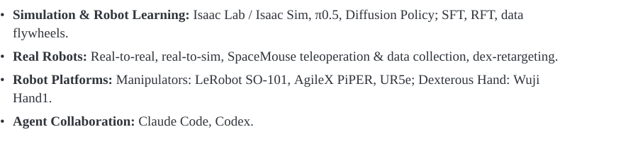

 &nbsp;  &nbsp; 

 
<picture><source media="(max-width: 600px)" srcset="https://raw.githubusercontent.com/YifanLiu-AI/YifanLiu-AI/main/assets/serif-compact/about-mobile.svg"></picture>
 

 

 
<picture><source media="(max-width: 600px)" srcset="https://raw.githubusercontent.com/YifanLiu-AI/YifanLiu-AI/main/assets/serif-compact/sjtu-denglab-mobile-intern-mono-type.svg"></picture>
 
<picture><source media="(max-width: 600px)" srcset="https://raw.githubusercontent.com/YifanLiu-AI/YifanLiu-AI/main/assets/serif-compact/slai-icon-slai-mobile-intern-mono-type.svg"></picture>
 
<picture><source media="(max-width: 600px)" srcset="https://raw.githubusercontent.com/YifanLiu-AI/YifanLiu-AI/main/assets/serif-compact/scut-miaa-mobile-intern-mono-type.svg"></picture>
 

 

 
<picture><source media="(max-width: 600px)" srcset="https://raw.githubusercontent.com/YifanLiu-AI/YifanLiu-AI/main/assets/serif-compact/robosyn-mobile-cv-sync.svg"></picture>
 
 &nbsp;  &nbsp;  
<picture><source media="(max-width: 600px)" srcset="https://raw.githubusercontent.com/YifanLiu-AI/YifanLiu-AI/main/assets/serif-compact/wrist-mobile-cv-sync-clean.svg"></picture>
 
 
<picture><source media="(max-width: 600px)" srcset="https://raw.githubusercontent.com/YifanLiu-AI/YifanLiu-AI/main/assets/serif-compact/lehome-mobile-cv-sync.svg"></picture>
 
 &nbsp;  

 

 
<picture><source media="(max-width: 600px)" srcset="https://raw.githubusercontent.com/YifanLiu-AI/YifanLiu-AI/main/assets/serif-compact/skills-mobile.svg"></picture>
 

 

 
<picture><source media="(max-width: 600px)" srcset="https://raw.githubusercontent.com/YifanLiu-AI/YifanLiu-AI/main/assets/serif-compact/education-mobile.svg"></picture>
 

 

